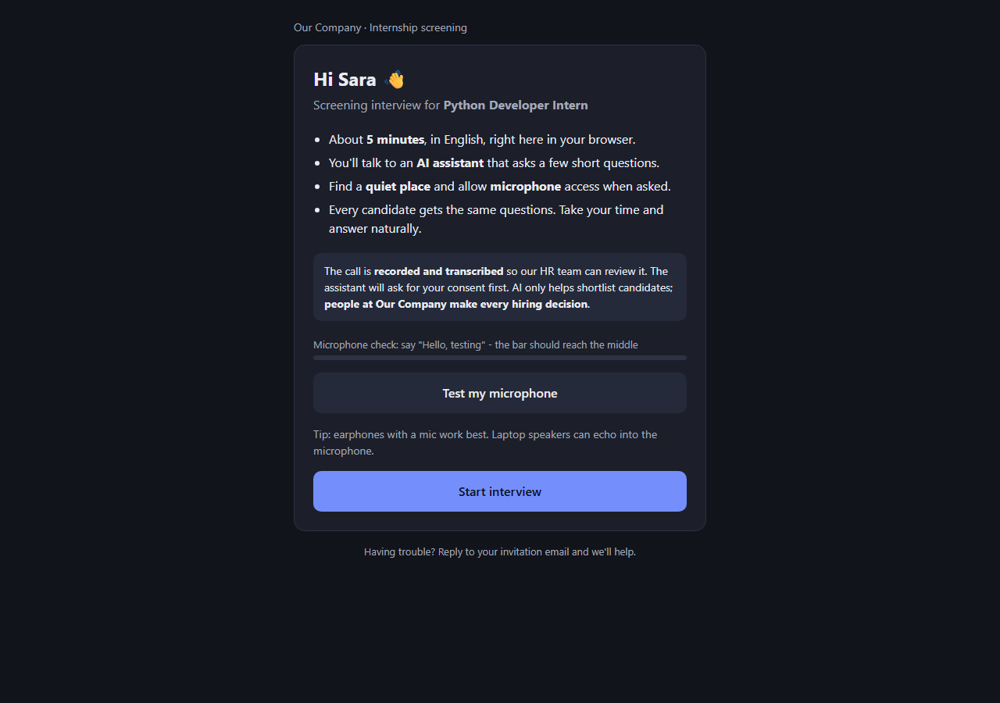
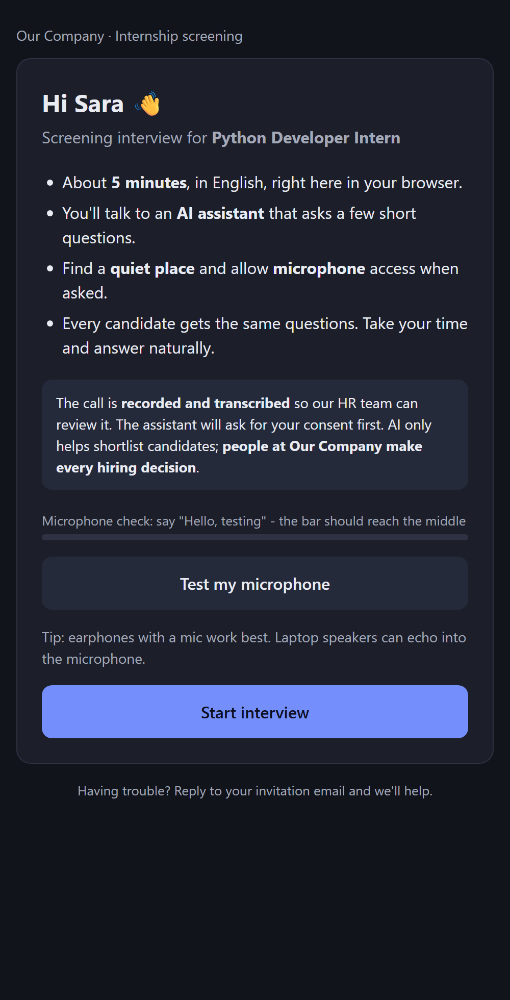
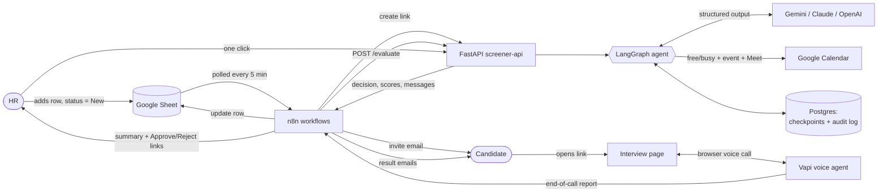
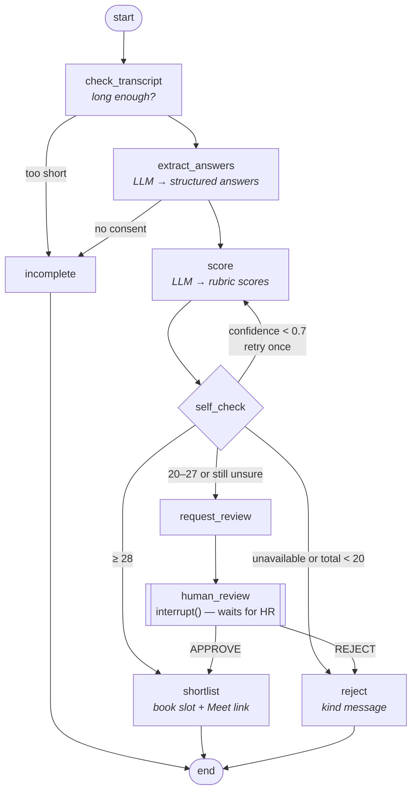

# AI Internship Screener

**An agentic AI system that screens internship candidates end to end.** HR adds a row to a
Google Sheet; the system invites the candidate, runs a 5-minute **voice interview** in the
browser, scores it with a **LangGraph decision agent**, books a **Google Meet** interview for
strong candidates and asks HR to decide borderline ones with one click.

> **The AI only shortlists. HR makes every hiring decision.** Every candidate gets the same
> questions and rubric, and every score, reasoning step and decision is logged.

[](https://github.com/Muneeb-akhtar/ai-internship-screener/actions/workflows/ci.yml)


🎥 **Demo video:** _coming soon_ · 🌐 **Live deployment:** `https://muneeb-screener.duckdns.org` (private routes only, see [Security](#security))

<p align="center">
  
  &nbsp;
  
</p>
<p align="center"><i>The candidate's interview page (live deployment): AI disclosure, consent notice and mic check before the voice call.</i></p>

---

## How it works



1. **Invite** – n8n finds `New` rows, the API creates an unguessable, expiring interview link,
   and the candidate gets an email. Status → `Invited` (one reminder after 24 h if unopened).
2. **Interview** – the candidate opens the link; after a mic check, the **Vapi Web SDK** starts a
   browser voice call with the AI interviewer "Ayla". It discloses that it's an AI, asks for
   consent, then asks **fixed, role-specific questions** (identical for everyone).
3. **Evaluate** – Vapi's end-of-call report reaches n8n, which calls `POST /evaluate`.
   The LangGraph agent scores the transcript (below).
4. **Act** – the result updates the Sheet and sends emails:
   - **≥ 28/40 → shortlisted:** a 30-min slot is found in HR's real calendar (working days,
     10:00–17:00 PKT) and an event with a **Google Meet link** is created.
   - **20–27 → human review:** HR gets the AI summary, a **link to the call recording** and
     signed **✅ Approve / ❌ Reject** buttons; the click resumes the paused agent.
   - **< 20 or not available → kind rejection** email (LLM-drafted, template fallback).
   - **Too short / no consent → incomplete:** a new link is sent once.

## The Screening Decision Agent (LangGraph)



- **Rubric:** communication, technical, problem solving, motivation (0–10 each, total /40) +
  availability, confidence and evidence-based reasoning, returned as **Pydantic structured output**.
  Thresholds are applied by deterministic Python, never by the LLM.
- **Reflection loop:** low confidence → re-score once; still unsure → a human decides.
- **Human-in-the-loop:** `interrupt()` pauses the graph; the **Postgres checkpointer** keeps the
  state, so a review can be answered days later, even after restarts.
- **Fair to accents:** prompts tell the scorer the transcript is speech-recognition output, so a
  possibly-misheard answer lowers *confidence* (→ human review) instead of the *score*.
- **Prompt-injection guard:** transcripts are treated as untrusted data.

## Tech stack

| Area | Tools |
|---|---|
| Agent | Python 3.12, **LangGraph**, LangChain, Pydantic, FastAPI |
| LLM | **Gemini** (default, with fallback model) — switchable to **Claude** or **OpenAI** via `.env` |
| Voice | **Vapi** Web SDK (browser call), Deepgram nova-3 transcription |
| Automation | **n8n** (self-hosted) — 6 workflows, generated from code |
| Integrations | Google Sheets, Google Calendar (Meet links), Gmail |
| Data | Postgres 16 (n8n data, LangGraph checkpoints, audit log) |
| Infra | Docker Compose, Caddy (automatic HTTPS), **AWS EC2**, S3 backups, IAM role |
| CI/CD | **GitHub Actions** (tests, lint, image build, config validation) + pull-based GitOps deploy |
| Built, switched off | Meta **WhatsApp** Cloud API (signed webhooks) and **ElevenLabs** WhatsApp voice calls |

## Engineering highlights

- **Workflows as code** – `scripts/n8n_workflows.py` generates all 6 n8n workflows and pushes them
  through the n8n API; CI fails if the exported JSON is stale.
- **Idempotent & resilient** – retried webhooks map to the same LangGraph thread (no duplicate
  evaluations or bookings); calendar events use deterministic ids; LLM calls retry with backoff
  and fall back to a second model; a crashed evaluation resumes from its last checkpoint.
- **Signed, expiring links** (HMAC) for interview pages, HR decisions and call recordings; HR
  decision links confirm via `POST` so email link-scanners can't trigger them.
- **Pull-based deployment** – the server deploys a commit only after **all CI checks passed**,
  health-checks it and **rolls back automatically**. No cloud keys stored in GitHub; SSH is closed.
- **Least privilege** – the server's IAM role can only *add* backups to S3; Google access is
  limited to creating events and reading free/busy.
- **94 automated tests** with a mocked LLM (no API keys needed), plus an optional live-LLM test.

## Security

- Only the routes the internet needs are public (interview pages, signed links, webhooks,
  `/health`); `/evaluate`, `/review`, API docs and the n8n editor are not reachable from outside
  (n8n is accessed through an SSH tunnel).
- Every machine-to-machine call uses a shared secret; Vapi, Meta and ElevenLabs webhooks are
  verified (shared secret / HMAC signatures).
- Secrets live only in `.env` and `secrets/` (git-ignored). The browser never receives private keys.

## Run it locally (Windows PowerShell)

Requirements: Docker Desktop, Python 3.12. Free accounts: Google AI Studio (Gemini key), Vapi.

```powershell
.\scripts\init-env.ps1                    # creates .env with random secrets
# add GOOGLE_API_KEY (and VAPI_* keys) to .env
docker compose -f docker-compose.yml -f docker-compose.dev.yml up -d --build
Invoke-RestMethod http://localhost:8000/health
.\scripts\try-evaluate.ps1 -Sample borderline   # run the agent on a sample transcript
```

Guides: [Vapi setup](vapi/README.md) · [Deploy to AWS](deploy/README.md) ·
[Demo script](docs/DEMO.md) · [Build log](PROGRESS.md)

## Tests

```powershell
cd screener-api; .\.venv\Scripts\Activate.ps1
pytest -q          # mocked LLM, ~5 s
```

## Repository layout

| Path | What |
|---|---|
| `screener-api/app/agent/` | LangGraph agent: state, nodes, graph, prompts, service |
| `screener-api/app/interview/` | Interview links, fixed question bank, Vapi page routes |
| `screener-api/app/tools/calendar.py` | Free-slot finder + Google Calendar/Meet booking |
| `screener-api/app/{hr_review,recordings,whatsapp}.py` | Signed HR links, recording links, WhatsApp webhook |
| `screener-api/app/voice/elevenlabs.py` | ElevenLabs WhatsApp calling (optional) |
| `scripts/` | Setup + automation: n8n workflows, Vapi, Google OAuth, tunnel, ElevenLabs |
| `n8n/workflows/` | Exported n8n workflows (generated) |
| `vapi/` | Voice interviewer prompt + config |
| `deploy/` | EC2 setup, auto-deploy, backup/restore |
| `.github/workflows/ci.yml` | CI pipeline |

## License

MIT — see [LICENSE](LICENSE).
