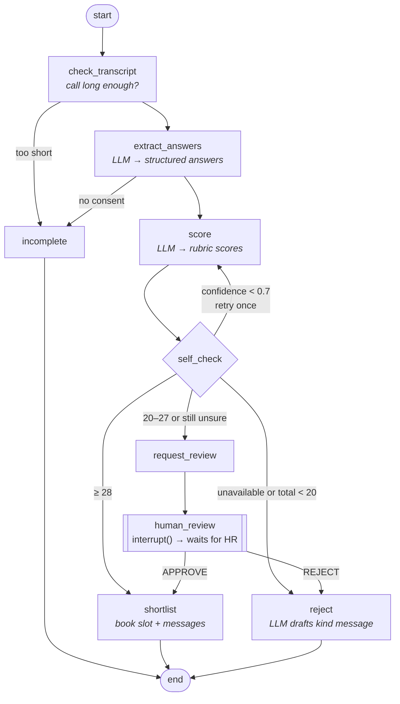

# AI Internship Screener

An agentic AI pipeline that screens internship candidates end to end: WhatsApp invite →
5-minute browser voice interview (Vapi) → LangGraph decision agent → calendar booking and
notifications through n8n. **The AI only shortlists; HR makes the final hiring decision.**

> 🚧 Work in progress. Phase 1 (Docker stack), Phase 2 (LangGraph agent) and Phase 3 (Vapi browser
> interview, see [vapi/README.md](vapi/README.md)) are built. See [PROGRESS.md](PROGRESS.md).

## Stack
FastAPI · LangGraph · Gemini/Claude/OpenAI (switchable) · n8n · Postgres 16 · Vapi ·
Meta WhatsApp Cloud API · Google Calendar · Caddy · Docker Compose · AWS EC2 · GitHub Actions

## Quick start (Windows PowerShell)
```powershell
.\scripts\init-env.ps1                       # creates .env with random secrets
# then add GOOGLE_API_KEY to .env (free key: https://aistudio.google.com/apikey)
docker compose -f docker-compose.yml -f docker-compose.dev.yml up -d --build
docker compose ps                            # wait until everything is "healthy"
Invoke-RestMethod http://localhost:8000/health

# Try the agent on a sample interview transcript (strong | borderline | weak)
.\scripts\try-evaluate.ps1 -Sample borderline
```
- n8n editor: http://localhost:5678
- API docs (Swagger): http://localhost:8000/docs

## Screening Decision Agent (LangGraph)


- **Rubric (same for everyone):** communication, technical, problem solving and motivation are each scored 0–10 (total out of 40). The LLM also returns `available`, `confidence` and evidence-based `reasoning`. Thresholds are applied by Python code, not by the LLM.
- **Reflection loop:** if confidence is below 0.7, the agent re-scores once. If it's still unsure, the candidate goes to HR instead of being auto-decided.
- **Human in the loop:** borderline candidates pause with `interrupt()`. The state is saved by the **Postgres checkpointer**, so the pause survives restarts. `POST /review/{thread_id}` resumes the graph.
- **Transparency:** every evaluation, every scoring attempt with its reasoning, and HR's decision are stored in the `evaluations` table.
- **Resilience:** retries with backoff, an automatic fallback model, idempotent `/evaluate` (a retried webhook with the same `call_id` never double-books), and resume-after-crash from the last checkpoint.
- **Prompt-injection guard:** transcripts are treated as untrusted data.

### API
| Method | Path | Purpose |
|---|---|---|
| GET | `/health` | Liveness + DB check (public) |
| POST | `/evaluate` | Run the agent on a transcript → decision, scores, interview, messages |
| POST | `/review/{thread_id}` | HR's `APPROVE` / `REJECT` for a borderline candidate |
| GET | `/evaluations/{thread_id}` | Current result |

Every endpoint except `/health` requires the `X-API-Key` header.

## Tests
```powershell
cd screener-api; .\.venv\Scripts\Activate.ps1
pytest -q                                          # 40+ tests, mocked LLM, no cost
$env:RUN_LIVE_LLM=1; pytest tests/test_live_llm.py -s; Remove-Item Env:RUN_LIVE_LLM   # real Gemini
```

## Privacy note
On the Gemini **free tier**, Google may use prompts to improve its products. Use it for demos with
sample transcripts. Before screening real candidates, use a paid tier or switch provider with
`LLM_PROVIDER=anthropic|openai` in `.env`.

## Repository layout
| Path | What |
|---|---|
| `docker-compose.yml` | Base stack: postgres, n8n, screener-api, caddy (`prod` profile) |
| `docker-compose.dev.yml` | Local overrides: localhost ports, hot reload |
| `postgres/init/` | Creates the `n8n` and `screener` databases on first start |
| `screener-api/app/agent/` | LangGraph agent: `state.py`, `nodes.py`, `graph.py`, `prompts.py`, `service.py` |
| `screener-api/app/tools/` | Interview scheduling (Google Calendar in Phase 4) |
| `screener-api/tests/` | pytest: agent flows, routing thresholds, slot finder, API, live LLM |
| `scripts/` | `init-env.ps1`, `try-evaluate.ps1` |
| `n8n/workflows/` | Exported n8n workflows |
| `vapi/` | Voice assistant prompt + config |
| `deploy/` | EC2 setup + backup scripts |
